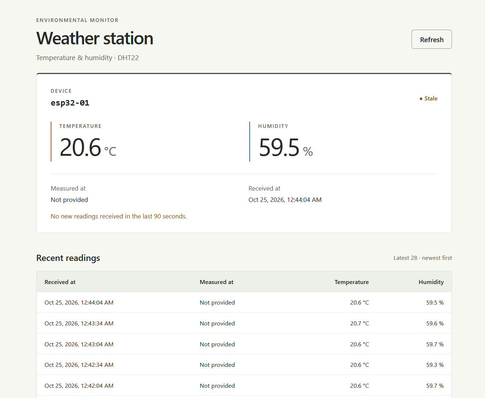

# Weather Station Dashboard

A minimal React + TypeScript dashboard built with Vite. Requires Node.js 20 or newer and npm. Prefer a currently supported Node.js LTS release for new installations.

[Project overview](../README.md) · [Backend guide](../backend/README.md) · [Hardware and firmware](../docs/hardware.md)

## Run locally

Start FastAPI first, from the repository root (see [backend instructions](../backend/README.md#run)). Keep the usual `--host 0.0.0.0` mode if receiving ESP32 readings.

In a second terminal, starting from the repository root:

```powershell
cd frontend
npm ci
npm run dev
```

Open the URL printed by Vite, normally <http://localhost:5173>.

Vite forwards `/api` requests to `http://127.0.0.1:8000`. The browser only connects to Vite, so no backend CORS changes are needed. If the API uses a different address, edit the proxy target in `vite.config.ts`. This proxy only exists during development.

### View on a phone

With the phone and computer on the same trusted LAN:

```powershell
npm run dev:lan
```

Open `http://<computer-lan-ip>:5173` on the phone. The proxy still connects to FastAPI on the computer, not on the phone. Allow TCP port 5173 from your trusted LAN through the firewall if necessary; do not disable the firewall. Stop Vite when finished.

**The dashboard and API have no login. Do not expose either server to the Internet.**

## Behavior

- One device, configured by `DEVICE_ID` in `src/api/readings.ts` (default: `esp32-01`). This filter is not authorization.
- One API request on startup, manual refresh, and every 30 seconds. Requests time out after 10 seconds and do not overlap.
- `/api/readings?device_id=esp32-01&limit=100` returns the latest 100 records, newest insertion first. Its first record supplies the device card, avoiding a separate latest-reading request. An empty list is a normal empty state; the latest-reading endpoint and its empty-state 404 are not used.
- Existing readings stay visible if refreshing fails. Automatic and manual retries remain available.
- `Fresh` means the latest reception is less than 90 seconds old; `Stale` does not prove the device is offline. Server and browser clocks should be synchronized.
- Dates use English formatting and the browser's timezone, identified below the dashboard. UTC API values are not modified.
- Missing `measured_at` displays `Not provided`; reception time never substitutes for measurement time.
- English interface, responsive device card, and horizontally scrollable history table on narrow screens.

## Checks

From `frontend/`:

```powershell
npm test
npm run build
```

Tests use mocked HTTP responses, never the development database. `npm run build` checks TypeScript and generates `dist/`.

## Structure

```text
src/
  api/readings.ts              API request, Reading type, and device ID
  components/DeviceCard.tsx    Device values, timestamps, and freshness
  components/ReadingsTable.tsx Latest readings table
  App.tsx                     Fetching, polling, loading, and error states
  App.test.tsx                Dashboard integration tests
  format.ts                   Local date formatting
  main.tsx                    React entry point
  styles.css                  Responsive styles
```

No router, global state library, chart library, or UI framework is needed for this screen.

## Screenshots



The screenshot shows the `Stale` state: the last available readings remain visible when no new data has arrived for at least 90 seconds.

Store additional desktop and mobile screenshots in `docs/images/dashboard/`. See the [image guide](../docs/images/README.md) for naming, privacy checks, and Markdown examples.

## Future deployment

Production hosting is not implemented yet. Vite's development proxy is not included in `dist/`. A future deployment should serve the compiled frontend and route `/api` to FastAPI under the same origin, or explicitly configure an API origin and CORS. `npm run preview` only previews the build; it does not provide the production API routing.

Authentication, server-enforced device permissions, HTTPS, device credentials, charts, PWA installation, and mobile packaging are separate future tasks. The responsive web interface can later be adapted as a PWA or packaged with Capacitor; this build alone is neither.
